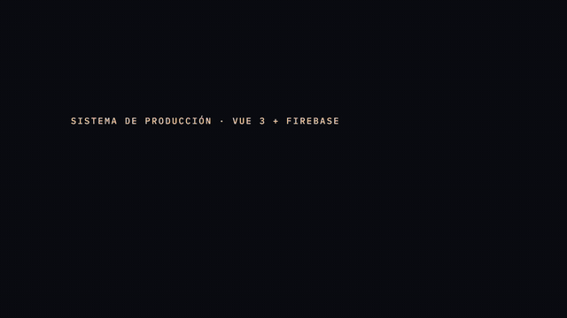
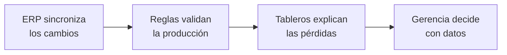
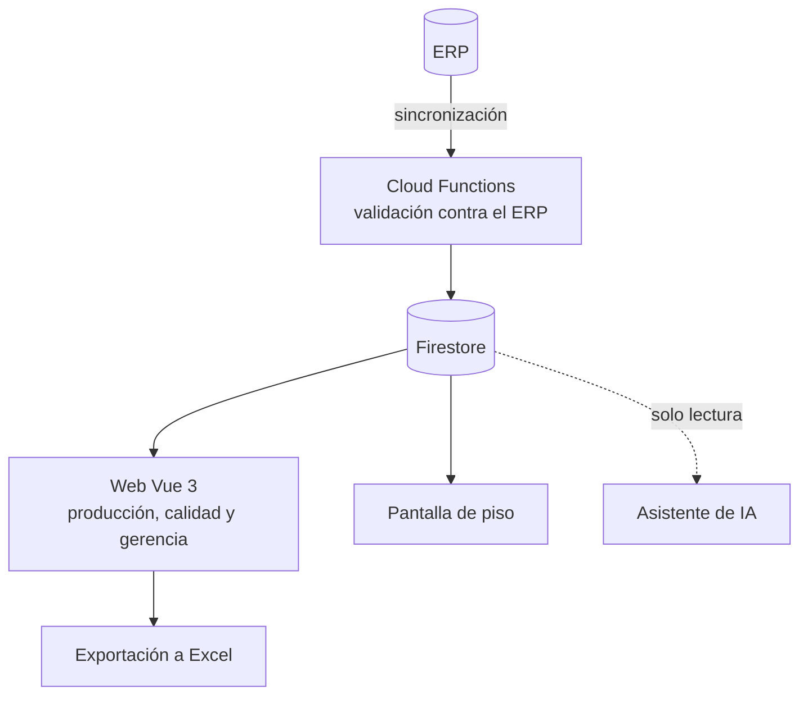
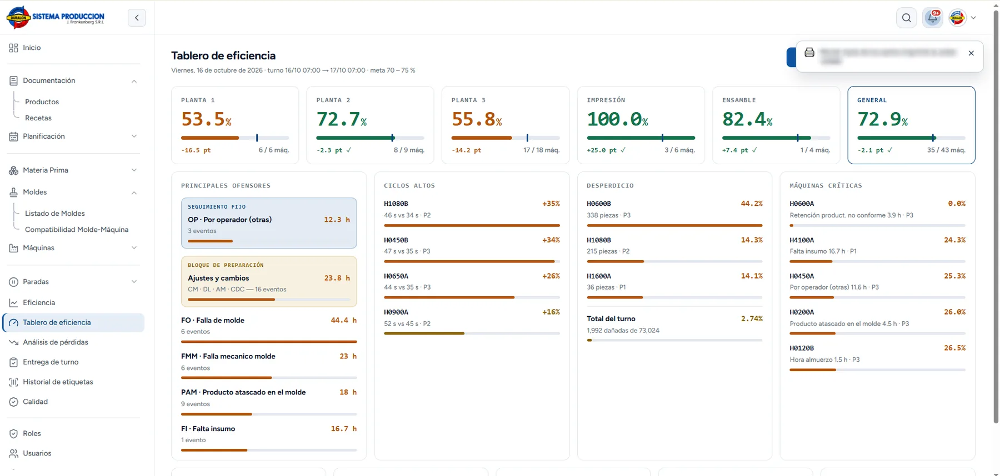
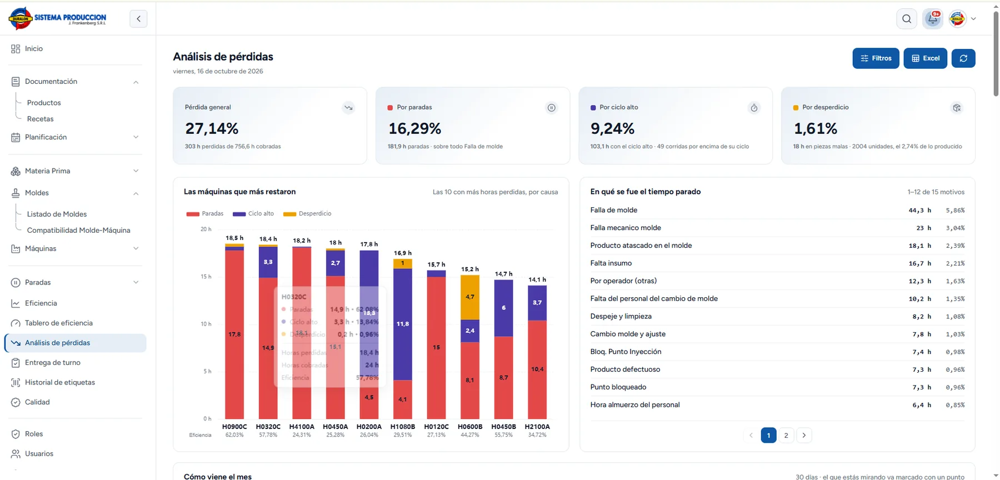
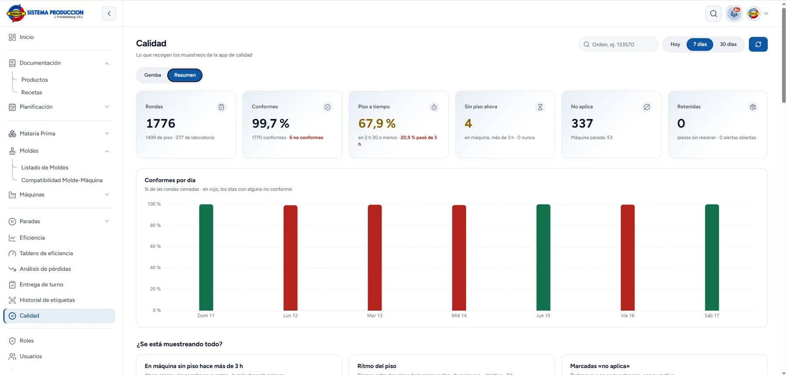

# JF Producción · Caso de estudio

> **Este repositorio es un caso de estudio, no contiene código.** El sistema es propiedad de la empresa donde está en producción y su código permanece privado. Aquí se muestra el problema, la solución, cómo funciona y los resultados.
>
> 🎬 Más proyectos: **[portafolio de Yeison Rojas](https://ai-automation-portfolio-cyan.vercel.app)**

Unifica el ERP, la planta y la gerencia en una sola fuente de datos para corregir información, medir la eficiencia y explicar las pérdidas.

*Recorrido real del sistema; los nombres y datos internos están ocultos.*

## El reto

Las órdenes se duplicaban, los materiales de producción quedaban mal asignados y los indicadores de planta no coincidían con el informe de gerencia.

## La solución

- **Sincronización con el ERP:** los cambios se validan contra el ERP antes de aceptarse.
- **Reglas de producción** que corrigen la asignación de materiales en las hojas de producción.
- **Tableros de eficiencia y pérdidas:** paradas, ciclo alto y desperdicio por máquina, motivo y orden.
- **Historial de correcciones** para saber quién cambió qué y cuándo.
- **Permisos en vivo**, vista móvil, pantalla para el piso de planta y exportación a Excel.
- **Asistente de IA de solo lectura** para consultar los datos sin poder modificarlos.

## Cómo funciona

## Resultados

| Indicador | Resultado |
|---|---|
| Órdenes duplicadas | **1,510** unificadas |
| Materiales | **5,919** corregidos en hojas de producción |
| Diferencias de catálogo | de **4,630 a 1,077** |
| Existencias | **32,750 kg** recuperados en pantalla |

## Arquitectura

## Decisiones técnicas

- **El ERP manda:** los cambios se validan contra el ERP antes de aceptarse, para que la planta y la gerencia vean los mismos números.
- **Historial de correcciones:** cada cambio queda registrado con quién lo hizo y cuándo.
- **Permisos en vivo:** un cambio de rol se aplica al instante, sin cerrar sesión.
- **IA de solo lectura:** el asistente puede consultar y explicar los datos, pero no tiene forma de modificarlos.
- **Pruebas automatizadas** sobre las reglas de producción que corrigen órdenes y materiales.

## Mi rol

Creador y arquitecto del sistema. Diseñé y dirigí el desarrollo de la sincronización con el ERP, las reglas de producción, los tableros de eficiencia y pérdidas, la trazabilidad, las pruebas automatizadas y la integración de IA de solo lectura.

## Stack

Vue 3 · Firebase (Firestore, Auth, Cloud Functions, Hosting) · Integración con ERP · Exportación a Excel · IA de solo lectura

## Capturas

  
  
  
  

---

## English summary

**JF Production** unifies the ERP, the shop floor and management into a single source of truth to correct data, measure efficiency and explain losses. Changes are validated against the ERP, production material rules are corrected, and dashboards show efficiency, downtime, high cycle times and waste by machine, cause and order. It includes a correction history, live permissions, a mobile view, a shop-floor screen, Excel export and a read-only AI assistant.

**Results:** 1,510 duplicated orders unified, 5,919 materials corrected, catalog differences reduced from 4,630 to 1,077, and 32,750 kg of stock restored on screen.

**Key engineering decisions:**
- ERP as the source of truth: changes are validated against it.
- Full correction history.
- Live permissions.
- Read-only AI assistant.
- Automated tests on production rules.

**My role:** creator and architect of the system. I designed and led the ERP sync, production rules, efficiency and loss dashboards, traceability, automated tests and the read-only AI integration.

**Stack:** Vue 3, Firebase (Firestore, Auth, Cloud Functions, Hosting).

*This is a case study. The source code belongs to the company and stays private.*
